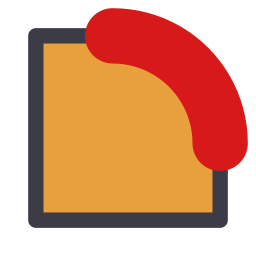
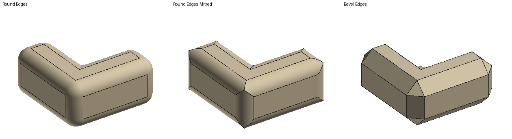
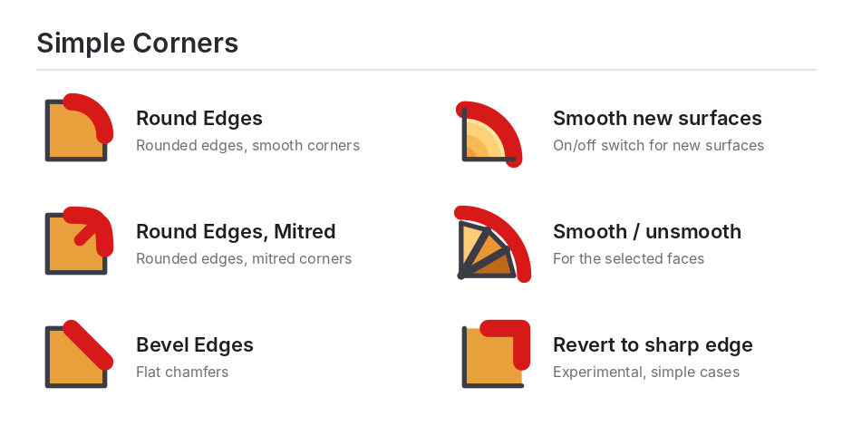

#  Simple Corners for SketchUp

Round, mitre or bevel the edges of your SketchUp models in one step,
including tricky corners where three or more edges meet, inner corners and
faces with holes.

## [⬇ Download Simple Corners (simple_corners.rbz)](https://github.com/TomaszDzieduszynski/simple-corners/releases/latest/download/simple_corners.rbz)

Version 1.2.1 · SketchUp 2017 or newer · Windows and Mac · free and open
source · signed by SketchUp's extension signing service

## Install

1. Click the download link above. You get one file, `simple_corners.rbz`.
   Do not unzip it.
2. In SketchUp open the **Extension Manager**:
   *Extensions > Extension Manager* (SketchUp 2017: *Window > Extension
   Manager*).
3. Click **Install Extension**, pick the downloaded `simple_corners.rbz`, and
   confirm.
4. The **Simple Corners** toolbar appears. If you don't see it, turn it on in
   *View > Toolbars*. All tools are also in *Extensions > Simple Corners* and
   in the right-click menu.

**Updating:** uninstall the old version in the Extension Manager first, or
restart SketchUp after installing the new one.

## Tools

| | Tool | What it does |
|---|---|---|
|  | **Round Edges** | Edges become rounded fillets; corners become smooth rounded patches. |
|  | **Round Edges, Mitred** | Edges become rounded fillets that run on and meet in crisp mitres at the corners. |
|  | **Bevel Edges** | Edges become flat chamfers; corners become flat facets. |
|  | **Smooth new surfaces** | On/off switch (on by default): new rounded surfaces get smooth, hidden segment lines. |
|  | **Smooth / unsmooth selection** | Smooths the edges between the selected faces, or unsmooths them if they are already smooth. |
|  | **Revert to sharp edge** | *Experimental.* Turns the selected rounded or bevelled surfaces back into sharp edges and corners; the rest of a rounded network stays rounded. |

## How to use

The tools work like SketchUp's own Circle and Offset tools.

1. **Pick what to change.** Select edges, faces or whole groups/components
   first, or start a tool and click an edge, face or group. Ctrl+click adds,
   Shift+click toggles (Option instead of Ctrl on Mac). What will change is
   shown in orange.
2. **Set the radius with two clicks:** the distance between the two points
   is the radius (for Bevel: the chamfer size). A red outline previews the
   result while you move the mouse.
3. **Or type it:** after the first click, type a length (`12`, `5mm`,
   `1.5cm`) and press Enter. Before the first click, a number sets the
   number of segments (`8` or `8s`). Enter alone repeats the last radius.
4. **Esc** steps back. **Ctrl+Z** undoes the whole operation in one step.

After applying, SketchUp switches back to the Select tool, like its own tools
do.

## Good to know

- **Radius too large for some edges?** The tools shrink it only on the edges
  where it does not fit, so nothing breaks. A notice tells you how many
  edges were reduced.
- **Groups and components:** select them and the whole object is processed.
  All copies of a component change together, because they share one
  definition.
- **Revert to sharp edge:** click a rounded or bevelled surface (one click
  selects a whole smooth surface; Shift+click adds more) and press the
  button. Select a whole rounded solid to make it sharp again, or only some
  fillets: those edges become sharp and the rest stays rounded as it was.
  It is experimental, so check the result (Ctrl+Z undoes it). A surface it
  does not recognise is left unchanged, with a message.
- **Very small models:** SketchUp cannot make edges shorter than about
  0.001". If a tiny radius fails, scale the model up (x10 or x100), apply,
  then scale it back down.
- **Very large selections** with many segments can take a while; the tool
  asks first.
- **No icon in the Extension Manager** is normal: SketchUp shows icons there
  only for extensions listed on its Extension Warehouse.

## License and credits

Vibecoded by Tomasz "bzqp" Dzieduszyński using Claude Opus 5.5, 2026.

Free software under the [GNU General Public License v3 or later](LICENSE):
you may use it for any work, including paid work, and share or change it, as
long as what you share stays under the same license.

What changed in each version: [CHANGELOG.md](CHANGELOG.md). For developers
(how it works, tests, building): [docs/DEVELOPING.md](docs/DEVELOPING.md).

## Inspirations

Functional references: the SketchUp extensions RoundCorner and Joint Push Pull
by Fredo6, and Blender's bevel tool, namely `set_profile_params()` (edge
profiles) and `adj_vmesh()` (corner patches) in
`source/blender/bmesh/tools/bmesh_bevel.cc`.
